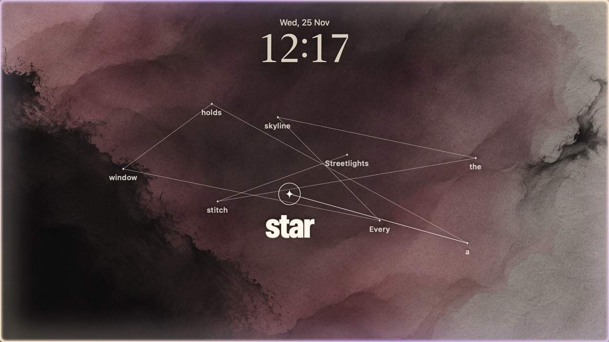

# VerseGlass

Word-synced lyrics for Spotify and Apple Music on Mac. Choose one of 13 styles, let the edges of your display pulse with the music, or take the lyrics full screen with the included screen saver.

**[Download for Apple silicon (.dmg)](https://github.com/Saad-Arsalan/VerseGlass/releases/latest/download/VerseGlass-macOS-arm64.dmg)** · [All releases](https://github.com/Saad-Arsalan/VerseGlass/releases)

Requires macOS 15 or later.



## Play your first song

1. Open the disk image, drag **Verseglass** to **Applications**, and launch it.
2. Play a song in the Spotify or Music desktop app. Allow playback access when macOS asks.
3. In VerseGlass, open **Lock Screen** and turn on **Show lyrics while unlocked** to see the words on your desktop.

[Setup and troubleshooting](docs/usage.md) · [Report an issue](https://github.com/Saad-Arsalan/VerseGlass/issues/new/choose)

## Build from source

With Xcode Command Line Tools installed, run these commands in a checkout of this repository.

```sh
./build.sh
open build/Verseglass.app
```

[Changelog](CHANGELOG.md) · [Roadmap](https://github.com/users/Saad-Arsalan/projects/2) · [Discussions](https://github.com/Saad-Arsalan/VerseGlass/discussions) · [MIT license](LICENSE)
